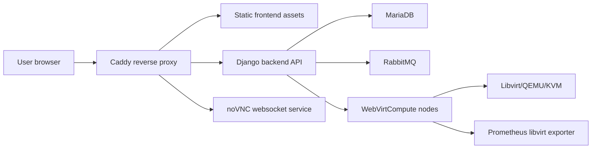

# webvirtcloud

[](https://hits.spiritlhl.net)

This repository packages deployment scripts and source snapshots for three related but different virtualization panels. They share a name lineage, but they are not interchangeable.

## Variants

| Path | Target | Upstream/source | Status | Use when |
| --- | --- | --- | --- | --- |
| `webvirtcloud/` + `scripts/install_webvirt_cloud.sh` | Modern WebVirtCloud controller, backend, frontend, MariaDB, RabbitMQ, Caddy | `oneclickvirt/webvirtcloud`, based on archived `webvirtcloud/webvirtcloud` components | Primary production path | You want the current Docker Compose based controller |
| `scripts/install_webvirt_cloud_retspen.sh` | Retspen WebVirtCloud fork | `oneclickvirt/webvirtcloud_retspen` from `retspen/webvirtcloud` | Legacy compatibility path | You need the retspen Django panel |
| `scripts/install_webvirtmgr.sh` | WebVirtMgr | `oneclickvirt/webvirtmgr` from `retspen/webvirtmgr` | Legacy Python 2.7 path | You specifically need WebVirtMgr |

`webvirtcloud/docker-compose.yml` is the production controller stack. `webvirtbackend/docker-compose.yml` is a development backend stack with hot reload and local-only ports.

## Architecture



## Quick Start

1. Clone and enter the repository.

```bash
git clone https://github.com/oneclickvirt/webvirtcloud.git
cd webvirtcloud/webvirtcloud
```

2. Choose a Caddy mode.

```bash
cp Caddyfile.selfsigned Caddyfile
mkdir -p .caddy/certs
openssl req -x509 -newkey rsa:4096 -keyout .caddy/certs/key.pem -out .caddy/certs/cert.pem -days 365 -nodes -subj "/CN=webvirtcloud.example.com"
```

3. Generate local runtime secrets.

```bash
./webvirtcloud.sh env
```

4. Start the controller.

```bash
./webvirtcloud.sh start
```

5. Save the generated admin password printed during first startup, then add compute nodes from the admin panel.

For unattended controller installation, use:

```bash
WEBVIRT_DOMAIN=webvirtcloud.example.com \
WEBVIRT_ADMIN_EMAIL=admin@example.com \
bash scripts/install_webvirt_cloud.sh --non-interactive
```

For LAN-only controllers or machines without a public IP, pass the LAN address directly:

```bash
WEBVIRT_DOMAIN=192.168.1.10 \
bash scripts/install_webvirt_cloud.sh --non-interactive
```

The installer falls back to the local LAN IPv4 address when no public IPv4 can be detected. For a bare IP, prefer `Caddyfile.noncert` or the installer-generated self-signed certificate with an IP SAN. For public HTTPS, use a real DNS name or `<ip>.nip.io`.

## Security Defaults

Production secrets are no longer stored in `env.common`. The generated `env.local` must provide:

| Variable | Purpose |
| --- | --- |
| `DJANGO_SECRET_KEY` | Django signing secret |
| `MARIADB_PASSWORD` / `DB_PASSWORD` | Application database password |
| `MARIADB_ROOT_PASSWORD` | MariaDB root password |
| `RABBITMQ_DEFAULT_PASS` | RabbitMQ password |
| `CELERY_BROKER_URL` | Broker URL with the RabbitMQ password |
| `WEBVIRT_ADMIN_EMAIL` | Initial admin email |
| `WEBVIRT_ADMIN_PASSWORD` | Initial admin password |

Caddy CORS headers are restricted to `DOMAIN_NAME`. In production, Django refuses to start without `DJANGO_SECRET_KEY` and `DB_PASSWORD`.

## Compute Nodes

Use `scripts/install_hypervisor.sh <controller-ip>` for a compute node. The script installs QEMU/KVM and libvirt, then verifies `libvirt >= 7.0.0` and the QEMU/KVM executable before installing WebVirtCompute.

WebVirtCompute stores its daemon token in `/etc/webvirtcompute/webvirtcompute.ini`; the committed template keeps this token empty and the install script generates the real value.

Backend Bearer tokens now enforce the `expired` date. Password resets and password changes rotate the user's obtained login tokens.

## Validation

Run the local baseline checks:

```bash
bash scripts/ci_check.sh
```

The GitHub Actions workflow also runs shell syntax checks, Docker Compose config validation, Python compilation, and security baseline scans.

## Uninstall

Controller cleanup:

```bash
cd webvirtcloud
./webvirtcloud.sh uninstall
```

Volumes are preserved by default. To remove volumes and locally built images too:

```bash
WEBVIRT_UNINSTALL_DELETE_VOLUMES=true ./webvirtcloud.sh uninstall
```

Deleting volumes removes database data. Back up `.mysql/`, `env.local`, and Caddy certificates first if you need to preserve data.

## Documentation

- Chinese: <https://www.spiritlhl.net/incomplete/webvirtcloud.html>
- English: <https://www.spiritlhl.net/en/incomplete/webvirtcloud.html>
- Retspen variant: <https://www.spiritlhl.net/incomplete/webvirtcloud_retspen.html>
- WebVirtMgr variant: <https://www.spiritlhl.net/incomplete/webvirtmgr.html>
