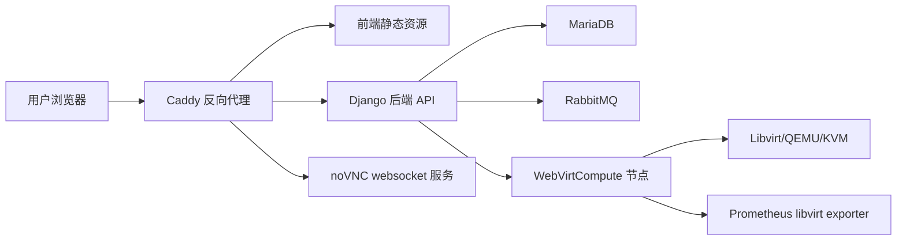

# webvirtcloud

[](https://hits.spiritlhl.net)

本仓库打包了三套相关但不同的虚拟化面板源码快照与部署脚本。它们名称相近，但上游、运行方式和适用场景不同，不能混用。

## 版本变体

| 路径 | 目标 | 上游/来源 | 状态 | 适用场景 |
| --- | --- | --- | --- | --- |
| `webvirtcloud/` + `scripts/install_webvirt_cloud.sh` | 现代 WebVirtCloud 控制器，包含 backend、frontend、MariaDB、RabbitMQ、Caddy | `oneclickvirt/webvirtcloud`，基于已归档的 `webvirtcloud/webvirtcloud` 组件 | 主要生产路径 | 需要当前 Docker Compose 控制器 |
| `scripts/install_webvirt_cloud_retspen.sh` | retspen 版 WebVirtCloud | `oneclickvirt/webvirtcloud_retspen`，来源为 `retspen/webvirtcloud` | 旧版兼容路径 | 需要 retspen Django 面板 |
| `scripts/install_webvirtmgr.sh` | WebVirtMgr | `oneclickvirt/webvirtmgr`，来源为 `retspen/webvirtmgr` | Python 2.7 旧版路径 | 明确需要 WebVirtMgr |

`webvirtcloud/docker-compose.yml` 是生产控制器栈。`webvirtbackend/docker-compose.yml` 是后端开发环境，带热重载和本地端口。

## 架构



## 快速开始

1. 克隆并进入仓库。

```bash
git clone https://github.com/oneclickvirt/webvirtcloud.git
cd webvirtcloud/webvirtcloud
```

2. 选择 Caddy 模式。

```bash
cp Caddyfile.selfsigned Caddyfile
mkdir -p .caddy/certs
openssl req -x509 -newkey rsa:4096 -keyout .caddy/certs/key.pem -out .caddy/certs/cert.pem -days 365 -nodes -subj "/CN=webvirtcloud.example.com"
```

3. 生成本地运行密钥。

```bash
./webvirtcloud.sh env
```

4. 启动控制器。

```bash
./webvirtcloud.sh start
```

5. 保存首次启动时打印的管理员密码，然后在管理面板添加计算节点。

无人值守安装控制器：

```bash
WEBVIRT_DOMAIN=webvirtcloud.example.com \
WEBVIRT_ADMIN_EMAIL=admin@example.com \
bash scripts/install_webvirt_cloud.sh --non-interactive
```

内网或没有公网 IP 的控制器也可以直接部署：

```bash
WEBVIRT_DOMAIN=192.168.1.10 \
bash scripts/install_webvirt_cloud.sh --non-interactive
```

脚本会在无法检测到公网 IPv4 时回退到本机内网 IPv4。使用裸 IP 时建议选择 `Caddyfile.noncert`，或使用脚本生成带 IP SAN 的自签名证书；如果需要公网 HTTPS，使用真实域名或 `<ip>.nip.io`。

## 安全默认值

生产密钥不再存放在 `env.common`。生成的 `env.local` 必须提供：

| 变量 | 用途 |
| --- | --- |
| `DJANGO_SECRET_KEY` | Django 签名密钥 |
| `MARIADB_PASSWORD` / `DB_PASSWORD` | 应用数据库密码 |
| `MARIADB_ROOT_PASSWORD` | MariaDB root 密码 |
| `RABBITMQ_DEFAULT_PASS` | RabbitMQ 密码 |
| `CELERY_BROKER_URL` | 带 RabbitMQ 密码的 Broker URL |
| `WEBVIRT_ADMIN_EMAIL` | 初始管理员邮箱 |
| `WEBVIRT_ADMIN_PASSWORD` | 初始管理员密码 |

Caddy CORS 响应头限制为 `DOMAIN_NAME`。生产环境中，Django 在缺少 `DJANGO_SECRET_KEY` 和 `DB_PASSWORD` 时会拒绝启动。

## 计算节点

计算节点使用：

```bash
bash scripts/install_hypervisor.sh <controller-ip>
```

脚本会安装 QEMU/KVM 与 libvirt，并在安装后验证 `libvirt >= 7.0.0` 以及 QEMU/KVM 可执行文件，再安装 WebVirtCompute。

WebVirtCompute 的真实守护进程 token 位于 `/etc/webvirtcompute/webvirtcompute.ini`；仓库中的模板保持为空，安装脚本会生成实际值。

后端 Bearer token 会执行 `expired` 日期校验；密码重置和修改密码会轮换用户已获取的登录 token。

## 验证

运行本地基线检查：

```bash
bash scripts/ci_check.sh
```

GitHub Actions 也会执行 shell 语法检查、Docker Compose 配置校验、Python 编译和安全基线扫描。

## 卸载

控制器清理：

```bash
cd webvirtcloud
./webvirtcloud.sh uninstall
```

默认会保留数据库卷。若要同时删除卷和本地构建镜像：

```bash
WEBVIRT_UNINSTALL_DELETE_VOLUMES=true ./webvirtcloud.sh uninstall
```

删除卷会清空数据库数据。若需要保留数据，请先备份 `.mysql/`、`env.local` 和 Caddy 证书。

## 文档

- 中文：<https://www.spiritlhl.net/incomplete/webvirtcloud.html>
- English：<https://www.spiritlhl.net/en/incomplete/webvirtcloud.html>
- retspen 版本：<https://www.spiritlhl.net/incomplete/webvirtcloud_retspen.html>
- WebVirtMgr 版本：<https://www.spiritlhl.net/incomplete/webvirtmgr.html>
